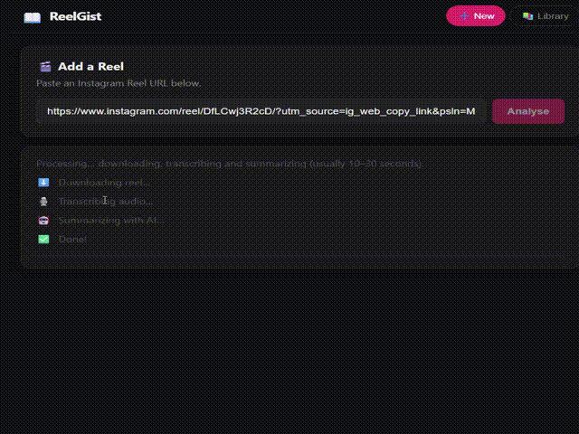

# ReelGist 📖

**Turn useful tech Reels into a searchable learning library.**

Paste an Instagram Reel link and ReelGist gives you a **gist card** you can trust, plus a timestamped transcript, saved to a personal library on your computer.



*Paste a reel link and scroll through the gist card, then open the Library, pick a saved reel and scroll through it.*

## What makes it different

- **Every point cites its source.** Each step, tool and tip shows the exact words it came from and a timestamp. Click the timestamp to jump to that line in the transcript. Anything the AI did not take word for word from the reel is marked **unverified**.
- **"What's missing from this reel?"** The card tells you what the creator mentioned but never actually gave you: the prompt behind "comment X to get it", settings shown only on screen, a link in their bio.
- **Prompts and commands, verbatim.** Spoken prompts, commands and settings are pulled out exactly as said, with a copy button.
- **Hindi and Hinglish reels.** Non-English reels are transcribed in their original language and also translated to English; the card is always in English, and you can switch the transcript between the original and English.

> ReelGist is an independent personal-use tool. It is not affiliated with, endorsed by or connected to Instagram or Meta.

---

## How it works

1. Paste an Instagram Reel URL into the app.
2. ReelGist downloads the audio with [`yt-dlp`](https://github.com/yt-dlp/yt-dlp).
3. Audio is transcribed by **Groq Whisper Large v3**. Non-English reels are also translated to English.
4. **Groq `gpt-oss-120b`** turns the timestamped transcript into a structured gist card. ReelGist then checks every quoted phrase against the transcript and marks anything it cannot find.
5. The result is saved to a local SQLite database (`insta_read.db`) and shown in your Library.

## Privacy

Your app and saved library run on your computer. **Audio is sent to Groq for transcription (and translation, for non-English reels), and transcript text is sent to Groq for summarization.** Internet access and a Groq API key are required. Groq's data handling is described at <https://console.groq.com/docs/your-data>; you can enable zero data retention in your Groq organization settings.

ReelGist has no telemetry, accounts or analytics.

## Limitations

- **Desktop only.** The backend runs on your computer and listens only on `127.0.0.1`; phones and other devices cannot reach it.
- **Personal use.** Downloading from Instagram uses your own exported login cookies (or anonymous access, which Instagram rate limits). You are responsible for complying with [Instagram's Terms of Use](https://help.instagram.com/581066165581870) and with creators' rights. Do not use it to republish other people's content.
- **Audio only.** It captures what is *spoken*. Anything shown only on screen, in a linked PDF or behind a "comment to get the link" gate is not captured.
- **Instagram changes often.** Downloads can break until `yt-dlp` is updated (see [Troubleshooting](#troubleshooting)).
- **Tested on Windows 11.** The macOS/Linux launcher (`start.sh`) has not been tested on a Mac yet; reports are welcome.

---

## Setup (one time)

### 1. Install Python 3.11+ and (optionally) ffmpeg

- Python: <https://www.python.org/downloads/>
- ffmpeg is only needed for very long reels (audio over ~24 MB). Short reels work without it.
  - Windows: `winget install ffmpeg`
  - macOS: `brew install ffmpeg`
  - Debian/Ubuntu: `sudo apt install ffmpeg`

### 2. Create a virtual environment and install dependencies

Windows (PowerShell):

```powershell
python -m venv .venv
.\.venv\Scripts\python.exe -m pip install -r backend/requirements.lock.txt
```

macOS / Linux:

```bash
python3 -m venv .venv
.venv/bin/python -m pip install -r backend/requirements.lock.txt
```

`requirements.lock.txt` pins every package to an exact, tested version. `requirements.txt` lists only the direct dependencies.

### 3. Add your Groq API key

1. Create a free key at <https://console.groq.com>.
2. Copy `backend/.env.example` to `backend/.env`.
3. Replace `gsk_your_key_here` with your key.

`backend/.env` is git-ignored. Never commit it.

### 4. Export your Instagram cookies (recommended)

Public reels sometimes work without this, but Instagram quickly rate limits anonymous downloads.

1. Log into instagram.com in your browser.
2. Export cookies for instagram.com in Netscape format, for example with the **"Get cookies.txt LOCALLY"** browser extension.
3. Save the file as `backend/cookies.txt` (git-ignored; treat it like a password).

Using your session for automated downloads can put your Instagram account at risk of restrictions. Consider a secondary account. Re-export the file when downloads start failing with a "fresh login" message.

---

## Running

Windows:

```powershell
.\start.ps1
```

macOS / Linux:

```bash
./start.sh
```

Your browser opens at <http://localhost:8080>. Press **Ctrl+C** in the terminal to stop.

---

## Troubleshooting

| Problem | Fix |
|---|---|
| "Instagram needs a fresh login" / "Could not download this reel" | Re-export `backend/cookies.txt`, then update yt-dlp: `pip install -U yt-dlp` (inside the venv) |
| "GROQ_API_KEY not set" | Add your key to `backend/.env` |
| "Audio is over Groq's 25 MB upload limit" | Install ffmpeg and restart the app |
| "ReelGist looks like it is already running" | An old instance holds port 5050 or 8080; stop it and start again |
| "Cannot reach the backend" | Make sure the start script is still running |
| Changes to the app don't appear in the browser | Reload the page twice (the app caches its files) |

---

## Project structure

```text
reelgist/
├── backend/
│   ├── app.py                # Flask API (port 5050)
│   ├── downloader.py         # URL validation + yt-dlp download
│   ├── transcriber.py        # Groq Whisper transcription + translation
│   ├── summarizer.py         # Gist card generation + evidence checking
│   ├── database.py           # SQLite library
│   ├── errors.py             # Shared error types
│   ├── requirements.txt      # Direct dependencies
│   ├── requirements.lock.txt # Exact pinned versions
│   └── requirements-dev.txt  # + test tools
├── frontend/                 # Plain HTML/CSS/JS app (installable as a desktop PWA)
├── tests/                    # pytest suite
├── start.ps1                 # Windows launcher
└── start.sh                  # macOS / Linux launcher
```

## Running the tests

```bash
# Windows: use .\.venv\Scripts\python.exe instead of .venv/bin/python
.venv/bin/python -m pip install -r backend/requirements-dev.txt
.venv/bin/python -m pytest tests -q
```

## Roadmap

The local edition will always be free and open source. Tell us what matters to you: 👍 an existing [issue](../../issues) or open a feature request.

### Done

- Evidence-linked gist cards with "What's missing from this reel?"
- Hindi and Hinglish reels with English translation

### Next

- Full-text search across your whole library
- Upload your own video or audio file, not just Instagram links
- Per-reel usage and cost log, and a faster, cheaper transcription option (Whisper Turbo)

### Exploring

- Reading text shown on screen (code, prompts, settings that are never spoken)
- An optional hosted version for people who don't want to install anything, with capture from your phone's share menu

## Contributing

Bug reports and ideas are welcome via GitHub Issues. Please never include your API key, cookies or private transcripts in an issue.

## License

ReelGist is licensed under the [GNU Affero General Public License v3.0](LICENSE). If you run a modified version as a network service, you must make your modified source code available to its users.
